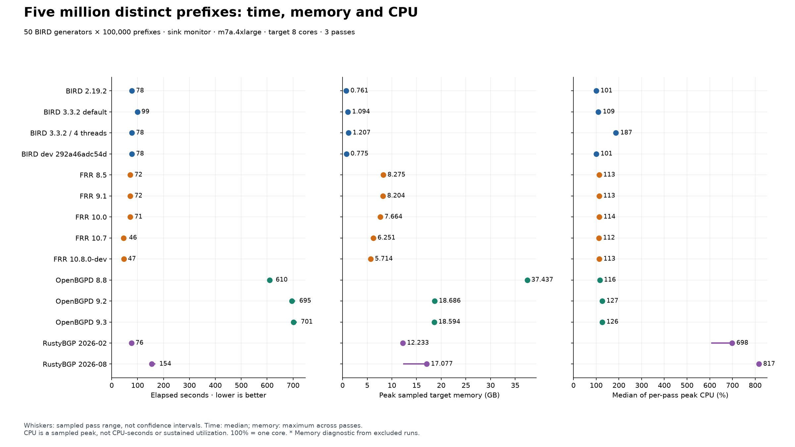
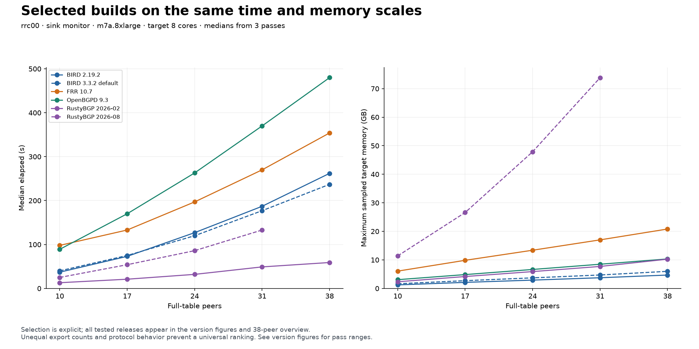
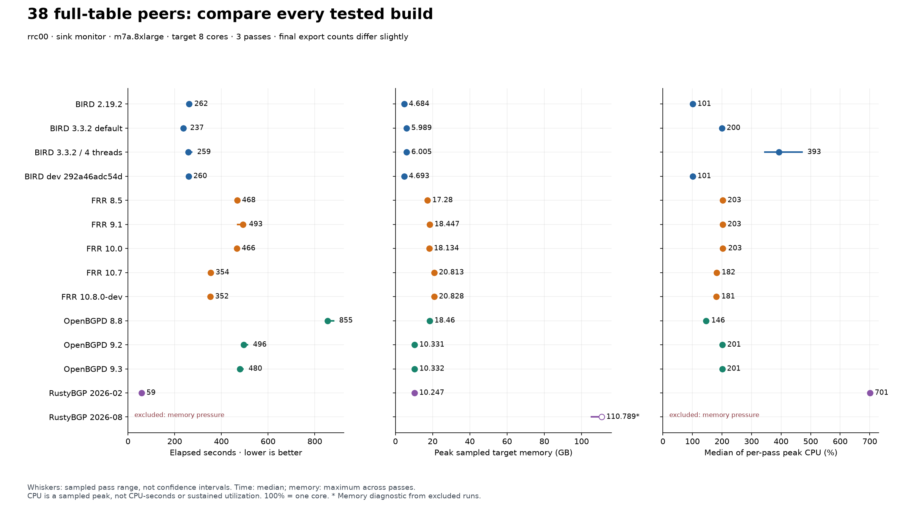
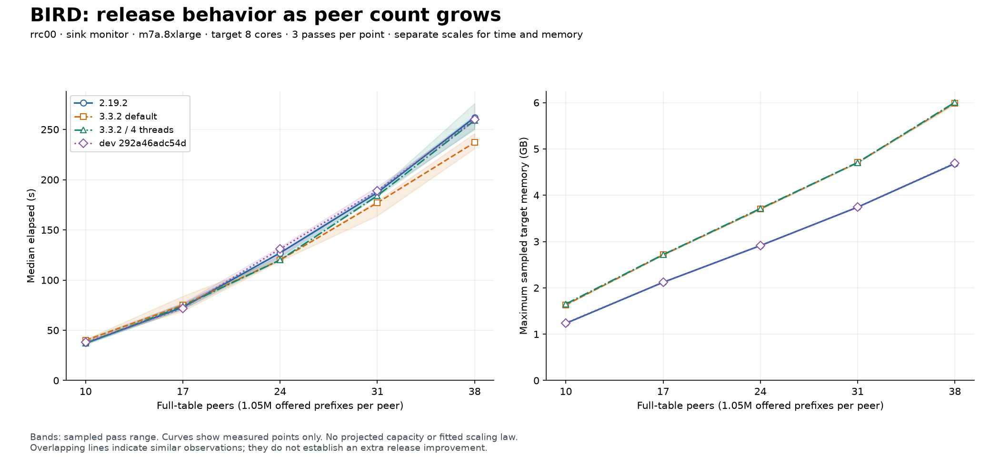
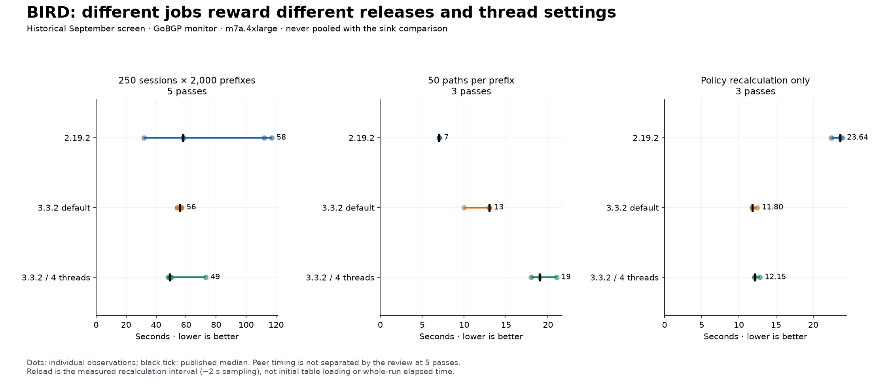
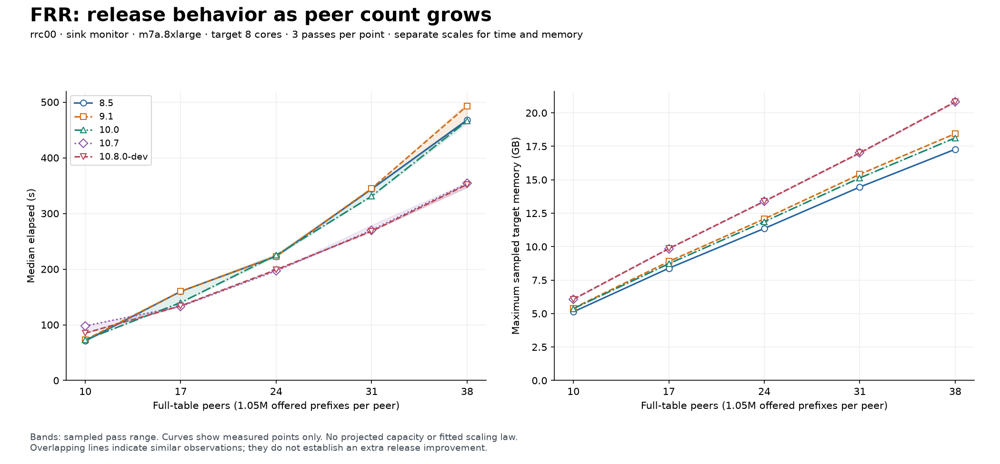
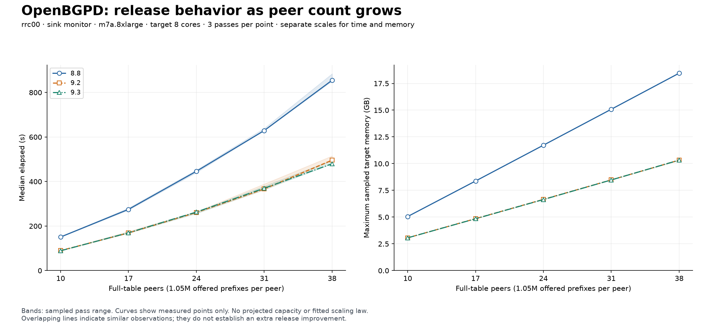
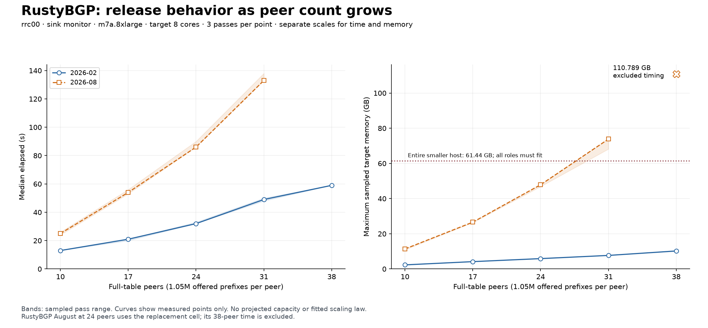
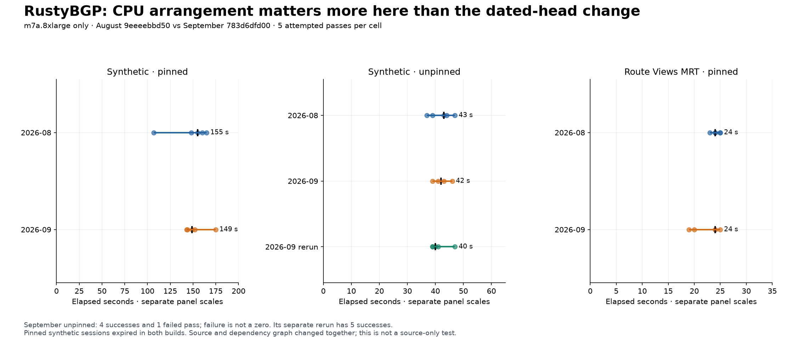

# What the 2026 tests tell us about open source BGP daemons

Updated 2026-10-09. Main comparison measurements through 2026-10-06, with
separately identified September experiments. These are the tested builds;
development labels do not mean today's upstream head.

**BIRD has the smallest target memory footprint in the main comparisons. FRR
10.7 improves the large synthetic-table result and the larger MRT cases, with
a memory tradeoff on MRT. OpenBGPD's newer releases substantially improve MRT
time and memory, while slowing the synthetic test. RustyBGP's February build
has the shortest MRT times, but later builds expose much larger memory costs
and session-health problems under some arrangements.**

Those differences matter to someone choosing a daemon or planning an upgrade.
A daemon that loads unique prefixes quickly may behave differently when many
peers offer alternative paths to the same destinations. A release can improve
one operation while costing more memory or CPU elsewhere.

The figures show measured observations rather than fitted performance models.
Small timing differences need to be read alongside the pass ranges. Export
behavior also differs between some daemons, so these are comparisons of the
tested configurations, not a universal ranking of implementations or
production readiness. The [evidence appendix](2026-daemon-comparison-evidence.md)
retains the detailed tables and measurement explanations.

## Comparing all the daemons

### Loading five million distinct prefixes

This is 50 peers advertising 100,000 unique prefixes each. Every build delivered
the complete table. Time includes delivery through the target to the monitor
and the convergence assurance rules. Memory is the largest sampled target
memory observation across the three passes.



**FRR 10.7 and its tested development build have the shortest median times in
this arrangement.** BIRD 2.19.2, BIRD 3 with four threads, and the tested BIRD
development build finish later but use much less target memory. OpenBGPD's
newer releases reduce its memory cost substantially, though it still takes
longer than the other families. RustyBGP's August result needs the session and
CPU-arrangement evidence discussed below.

The CPU panel describes sampled peaks: it does not measure total CPU work,
energy, or sustained utilization. A shorter time does not necessarily mean
fewer resources. Source:
[synthetic summary](../results/2026/2026-comparison/synth/2026-comparison-synth.summary.json).

### Receiving full tables from more peers

Each peer offers up to 1.05 million prefixes from a distinct peer in the same
RIS rrc00 dump. More peers add sessions and alternative paths, while largely
sharing destinations. This is a different workload from five million distinct
synthetic prefixes.



The shared scales make the family differences visible. BIRD stays below the
tested FRR and OpenBGPD releases in elapsed time along this curve and has a
smaller memory footprint. RustyBGP February finishes sooner, while August's
memory cost rises steeply. These selected curves show two BIRD arrangements,
FRR 10.7, OpenBGPD 9.3 and both RustyBGP builds. The next figure includes every
tested build at the largest step.



RustyBGP August has no accepted timing at this step: its runs violated the
free-memory guardrail. Its hollow memory point remains visible as a diagnostic.
The other rows are accepted end-to-end observations, but do not all export
exactly the same prefixes. BIRD and OpenBGPD each deliver 1,131,785 prefixes
here, while RustyBGP February delivers 1,131,993. The remaining rrc00 count
differences are not fully explained. Sources and exact counts are in the
[evidence tables](2026-daemon-comparison-evidence.md#export-volume-and-pass-spread-at-38-peers).

## BIRD has low memory use and workload dependent benefits from threads



**BIRD 2.19.2 is a strong memory baseline in these tests.** BIRD 3.3.2 uses more
memory in both main workloads. The tested development build identifies itself
as `2.19.0+branch.master.292a46adc54d`; it behaves much like 2.19.2 here and
should not be read as an unspecified newer BIRD 3 release.

Thread settings do not produce one consistent ordering. On the synthetic
table, BIRD 3's default arrangement takes 99 s versus 78 s with four threads
and 78 s for BIRD 2.19.2. At 38 rrc00 peers, the default arrangement has the
shortest median of the BIRD cells, 237 s, versus 259 s with four threads and
262 s for 2.19.2. Four workers are therefore not an automatic performance
upgrade for this workload. The graphs describe the effect; they do not identify
the internal scheduling or locking mechanism.

### Earlier tests show why initial table loading is not the whole BIRD story



These September tests used the **GoBGP monitor on the smaller host**. They are
separate evidence, not additional points on the sink-based curves above.

- **Session-heavy workloads:** at 250 sessions, BIRD 2's five elapsed
  observations range from 32 to 117 s. BIRD 3 default ranges from 54 to 57 s.
  Their published medians, 58 and 56 s, do not establish a speed advantage
  under the review's rule. The tighter observed spread is the clearer
  distinction. Four threads have a 49 s median but include a 73 s pass, so
  even that median should not become an unconditional speedup claim.
- **Many alternative paths:** with 50 paths per prefix and five million
  offered paths, BIRD 2's median is 7 s, BIRD 3 default is 13 s, and four
  threads is 19 s. More workers did not help this test.
- **Policy recalculation:** BIRD 3 default completes the measured recalculation
  in about 11.80 s versus 23.64 s for BIRD 2. Four threads give about 12.15 s,
  with no clear additional benefit at the roughly 2 s sampling resolution.
  These are recalculation intervals, separate from the initial-load elapsed
  field, which favors BIRD 2 in those runs.

For an operator, policy-change latency, session behavior, and initial table
loading deserve separate comparisons. Sources:
[session review](../results/2026/2026-timing-validation/block12-final-report/review/screen-peers.json),
[path-diversity review](../results/2026/2026-timing-validation/block12-final-report/review/screen-diversity.json),
[reload review](../results/2026/2026-timing-validation/block12-final-report/review/screen-reload.json).
The exact reload medians are 11.798147, 23.639333 and 12.14695 s; displayed
rounding does not imply finer measurement resolution.

## FRR 10.7 changes the time and memory tradeoff



**FRR 10.7's advantage is clearest on the large synthetic table and at higher
MRT peer counts.** The synthetic median falls from 71–72 s for 8.5, 9.1 and
10.0 to 46 s for 10.7, while the largest sampled memory falls from
7.664–8.275 GB to 6.251 GB.

MRT reverses the memory direction. At 38 peers, 10.7 finishes in a median
354 s versus 466–493 s for the older releases, but peaks at 20.813 GB rather
than 17.280–18.447 GB. At ten peers, 10.7 is slower than those older releases.
The curve makes that crossover visible; a single small experiment would give
an incomplete upgrade story.

The tested `10.8.0-dev` build follows 10.7 closely at the larger steps. These
observations do not establish an additional development-build improvement.
The higher 9.1 median at 38 peers includes a pass close to 8.5 and 10.0, so it
should not become a general claim that 9.1 is slower.

Some FRR Route Views runs deliver a small final group of prefixes after a long
pause, so bulk delivery and final convergence can tell different stories.
These FRR configurations also enable debug logging; its cost has not been
isolated. Neither finding explains the release differences by itself. See the
[behavior evidence](2026-daemon-comparison-evidence.md#the-tail-session-health-and-cpu-arrangement-can-change-the-story).

## OpenBGPD improves on shared tables while trading time for memory on unique routes



**The move from 8.8 to 9.2 is a substantial improvement for the MRT workloads
tested here.** Both 9.2 and 9.3 finish sooner and use less memory than 8.8
throughout the peer curve. At 38 peers, 8.8 takes a median 855 s and peaks at
18.460 GB, compared with 496 s and 10.331 GB for 9.2, and 480 s and 10.332 GB
for 9.3. The sampled ranges do not support turning the close 9.2/9.3 result
into a precise release ranking.

The synthetic result is a different tradeoff: 8.8 takes 610 s and peaks at
37.437 GB; 9.2 takes 695 s and peaks at 18.686 GB. The large memory reduction
comes with a longer initial convergence time. An operator receiving many
versions of an Internet table should not infer performance from the
distinct-prefix test alone.

Giving the monitor more cores did not remove OpenBGPD's post-injection wait
on the tested Route Views workload. The evidence places that wait inside the
target, but does not identify a particular internal process or justify a broad
claim that more cores never help OpenBGPD. Source:
[controlled experiment](2026-daemon-comparison-plan.md#6-phase-4--attribute-on-one-larger-host).

## RustyBGP combines short MRT times with significant build and capacity differences



**The February and August builds are materially different choices in these
experiments.** February has the shortest elapsed medians on the rrc00 curve.
August uses much more memory, and the gap grows as peers are added: at 31
peers the target peaks at 73.829 GB versus February's 7.701 GB. At 38 peers,
August reaches 110.789 GB and violates the host free-memory guardrail; its time
is excluded. February stays at 10.247 GB at that step.

A controlled bisect localized an MRT memory increase to commit `bd40d626`,
which changed the RIB to track and emit changes for all paths. That is stronger
evidence than a correlation between releases. The detailed allocation
mechanism remains an inference from the source change, and the measurements
do not establish an asymptotic complexity law. Source:
[bisect record](2026-daemon-comparison-plan.md#3-phase-1--questions-answerable-from-existing-evidence).

### The later tested head did not remove the arrangement sensitivity



The separately tested September build, `783d6dfd00`, retained hold-timer
expiries on every pinned synthetic pass. Both August and September finish much
sooner in the unpinned synthetic arrangement on the same larger host. Their
pinned MRT medians are both 24 s. The source and dependency graphs changed
together, so this is a comparison of builds rather than an isolated source
change.

September's original unpinned cell also has one failed pass with no received
prefixes. A separate rerun succeeds in all five passes; it does not erase that
failure. The latest upstream RustyBGP has not been tested by this report.

Protocol behavior belongs beside the performance. Source inspection of the
tested RustyBGP builds found no automatic NO_EXPORT/NO_ADVERTISE enforcement
in this configuration. The February build also emitted a malformed AS_PATH in
a recorded edge case that later builds handled correctly. Short times cannot
substitute for checking required behavior. These are findings about the named
builds, not today's upstream implementation. See the
[behavior ledger](2026-daemon-comparison-plan.md#8-known-differences-and-deficiencies-between-daemons).

## Which tests needed more than 64 GB and why they mattered

The nominal 64 GB campaign host exposes about 61.44 GB in the result files.
The larger peer sweep ran on a host exposing about 123.12 GB, with more CPU
cores as well. Running on that host does not itself prove a test needed more
than 64 GB of RAM.

**RustyBGP August at 31 and 38 full-table peers definitely exceeded the smaller
host's capacity:** the target alone used 73.829 and 110.789 GB, before the
generators, monitor, and operating system. The 31-peer result was accepted on
the larger host. At 38 peers, even that host had insufficient headroom: free
memory reached 1.314 GB, and all three passes violated the 15% free-memory rule.
The memory observations remain evidence; their elapsed times are excluded.

**The 24-peer replacement cell is a headroom concern rather than a demonstrated
hard 64 GB limit.** Its target peaks at 47.877 GB, leaving limited room on the
smaller host for 24 generators and the other roles. It was not rerun on a
64 GB host, so this report does not claim that it would necessarily fail or
meet the free-memory guardrail there.

**The principal synthetic comparisons did not require the larger host.** They
ran on the smaller one, including OpenBGPD 8.8's 37.437 GB target peak. The
larger host was also used for controlled core allocations, RustyBGP's dated-head
comparison, and a consistent setup across the peer sweep. Those uses should
not be described as RAM requirements for every daemon. Sources:
[synthetic](../results/2026/2026-comparison/synth/2026-comparison-synth.summary.json),
[24-peer rerun](../results/2026/2026-comparison/rrc00-n24-rustybgp-rerun/2026-comparison-rrc00-n24-rustybgp-rerun.summary.json),
[31 peers](../results/2026/2026-comparison/rrc00-n31/2026-comparison-rrc00-n31.summary.json),
[38 peers](../results/2026/2026-comparison/rrc00-n38/2026-comparison-rrc00-n38.summary.json).

**The larger tests were important.** The small MRT test already showed a
RustyBGP memory regression; the sweep established its operational consequence:
August exceeded the smaller host's capacity while February remained far below
it. The same sweep exposed FRR's release-order crossover and BIRD's different
threading result at larger sizes. Those latter differences required a larger
workload, but are not evidence that those daemons themselves needed more than
64 GB.

Earlier memory-planning documents projected larger matrices from approximately
linear growth. RustyBGP August's observed curve is a reason to recalibrate
those projections before promising 50 or 100 full-table peers on a particular
memory tier. No extrapolated capacity limit is established here.

## What to test next

The next experiments should answer operator questions: whether an upgrade
helps, whether the daemon behaves correctly under load, and whether it fits
the intended role. These are proposed experiments, not runs already scheduled
or completed.

### First refresh RustyBGP

Test the latest upstream RustyBGP against the retained February and August
builds on the same host with the same workload definitions. The project's
current installation path includes moving nightly binaries; resolve the
selected revision to a commit and record the binary and dependency identities
before running. A latest or nightly label alone is insufficient. Source:
[RustyBGP upstream](https://github.com/osrg/rustybgp).

Start with the five-million-prefix synthetic test under both CPU arrangements,
and the rrc00 steps at 10 and 17 peers. Continue through 24 and 31 peers only
while memory headroom is adequate. Recheck hold-timer expiry, the original
failed-start symptom, memory growth, NO_EXPORT/NO_ADVERTISE handling, and the
malformed-path edge case. The questions are whether the current build changes
the measured costs and whether it preserves required behavior. Its current
feature list is not evidence that these particular findings have been fixed.

### Broaden the implementations under test

These projects are candidates beyond this campaign's four daemon families.
Descriptions were checked against project sources on 2026-10-09; they describe
project scope, not independently verified performance or feature conformance.
Some are new to this comparison rather than newly created.

- **[rustbgpd](https://github.com/lance0/rustbgpd)** is a distinct project from
  RustyBGP, aimed at programmable route servers, route reflectors and network
  automation. Its documented policy interfaces make it a useful candidate
  for table loading and live policy-change tests. The project describes a
  narrow compatibility contract while remaining alpha overall.
- **[Holo](https://github.com/holo-routing/holo)** is a Rust routing suite whose
  documented BGP support includes route reflection, communities and revised
  UPDATE error handling. It would broaden the comparison to another routing
  suite and implementation architecture.
- **[zebra-rs](https://github.com/zebra-rs/zebra-rs)** is a separate Rust routing
  stack with BGP, OSPF and IS-IS. Begin with common IPv4/IPv6 unicast workloads
  before expanding into its documented VPN and EVPN capabilities.
- **[Bio-Routing](https://github.com/bio-routing/bio-rd)** provides a routing
  daemon in Go. It would add an implementation outside both the C families and
  Rust candidates; verify the selected build's supported role and policy
  behavior before admitting it to the shared matrix.
- **[Maghemite](https://github.com/oxidecomputer/maghemite)** is another Rust
  routing stack worth a scoped evaluation. Check its deployment assumptions
  before deciding whether it belongs in the generic full-table comparison or
  a separate datacenter routing experiment.

Prioritize small integration and correctness checks for rustbgpd and Holo,
then admit candidates to repeated comparisons once their configuration and
export behavior are understood. This order is a research recommendation,
not a maturity or speed ranking. Freeze exact revisions for every entrant.

### Measure the operations people run after the table has loaded

- **Policy changes under continuing updates:** measure time until the new
  policy is fully reflected downstream, disruption to unrelated routes,
  session health and transient memory. BIRD's reload result shows why initial
  loading alone misses a useful release distinction.
- **Withdrawal and recovery:** remove a peer or preferred path, measure
  replacement-path delivery and recovery, and repeat long enough to expose
  retained memory or intermittent session failures.
- **Route-server and route-reflector fan-out:** vary receivers and policy
  groups independently from input peers. A single output monitor does not
  describe per-client export cost. The earlier fan-out screen was confounded
  and does not settle this comparison.
- **IPv6 and mixed IPv4/IPv6 tables:** check whether the same release tradeoffs
  persist. This report's main workload cannot answer that.
- **Bulk delivery versus the last routes:** measure both bulk progress and
  final required export state, especially for FRR's delayed tail. Never drop
  the remaining prefixes merely to make the timing look better.
- **Memory and core scaling independently:** vary destinations, paths per
  destination, sessions and target cores separately. Include settled memory
  and reclamation after withdrawal alongside peaks. Recalibrate larger-memory
  experiments from measured cells rather than extrapolating August RustyBGP's
  small-table result.

Current stable releases of the established daemons should accompany those
experiments, pinned at campaign start. Keep historical builds as explicit
upgrade baselines. New entrants and the latest RustyBGP belong on measured
comparison graphs only after they have actually run.

### What larger hosts could tell us

Larger-memory hosts are readily available for this research. Treat 256 GiB,
512 GiB and larger machines as available experimental resources; choose the
size to answer the question with adequate headroom. There is no research
requirement to stop at 256 GiB or exhaust every smaller host first. More RAM
does not itself establish a daemon's usable capacity, and more cores must be
tested as a separate variable.

The most useful questions are:

- **Where does each daemon's practical capacity end?** Repeat the 31- and
  38-peer workloads, including the latest RustyBGP, on a host with enough RAM
  to retain the campaign's free-memory margin. August RustyBGP's 38-peer timing
  is currently excluded for inadequate headroom; a larger host could provide
  an accepted timing observation. Extend the peer curve in measured steps to
  establish how memory and completion time grow, and whether versions diverge
  further. Do not infer a 100-peer capacity from a small-table linear estimate.
- **Which kind of scale is expensive?** Vary unique destinations, alternative
  paths per destination, sessions, and export receivers independently. The
  rrc00 sweep mostly adds paths to shared destinations, while the synthetic
  workload adds unique destinations. Larger experiments could distinguish
  costs relevant to a router receiving a few full tables from those relevant
  to a route server or reflector serving many clients. Test representative
  export policies as well as receiver counts.
- **Can the daemon use additional cores effectively?** Sweep target core
  allocations and supported thread settings while holding generator and
  monitor allocations fixed and checking their headroom. Measure elapsed
  time and CPU-seconds to show both speed and processing cost. The existing
  Phase 4 core-allocation experiments did not establish improvements beyond
  pass variation; more hardware is a hypothesis to test, not a promised fix.
- **Does a large table remain operational under change?** At several table
  sizes, withdraw a full-table peer, change policy, restart sessions and
  sustain churn. Measure downstream recovery, session failures, transient
  memory, and memory reclamation or reuse. Successful initial loading alone
  cannot establish that a deployment will remain responsive during failures
  or maintenance.
- **Are generators or receivers concealing a difference?** Reserve sufficient
  resources for larger export fan-out, or place those roles on separate
  machines. Repeat overlapping control workloads before interpreting the
  results: changing hosts or moving traffic across a network changes the
  experiment, even when the target's core allocation stays the same.

A useful campaign would first refresh the current builds at known workload
sizes, repeat the 31- and 38-peer comparison on the selected larger host, then
extend capacity and recovery tests together. Use early measurements to size
the remaining runs and preserve the free-memory guardrail at every step.
Memory availability makes larger experiments feasible; session instability,
incorrect export, or unacceptable recovery time may establish an operational
limit well before memory runs out. Such outcomes belong in the comparison
even when other daemons can continue to larger workloads.

Present the results primarily as curves: memory versus workload size,
convergence and recovery time versus workload size, and elapsed time versus
target cores. Distinguish daemon versions, show repetition ranges, and mark
failed or excluded cells explicitly. These graphs should help an operator
answer: **which daemon and version will remain responsive for my deployment,
and what hardware will it need?** They are proposed figures; this report does
not yet contain measurements from these larger experiments. Existing evidence:
[memory findings](#which-tests-needed-more-than-64-gb-and-why-they-mattered) and
[Phase 4 controlled experiments](2026-daemon-comparison-plan.md).

## Evidence and reproducibility

The main synthetic experiment used an EPYC 9R14 m7a.4xlarge, with eight target
cores, two monitor cores and six generator cores. The rrc00 sweep used an
m7a.8xlarge, also with eight target cores and two monitor cores, but eighteen
generator cores. Do not compare their absolute times as if only the route
shape changed. Each main point has three passes. Dated-head cells have five
attempted passes, and the historical BIRD figure states its counts.

Whiskers and bands show observed pass ranges, not confidence intervals.
Memory means maximum sampled target-container memory across passes, not RSS
alone or a proven capacity limit. CPU panels show the median of sampled
per-pass peaks, not CPU-seconds. The 24-peer RustyBGP August rerun replaces the
original invalid cell; the 38-peer August timing stays excluded.

The report adds interpretation and views of existing evidence, not new
benchmarks. Earlier claims that waiting for generators proves a generator
bottleneck should not be carried forward: target back-pressure can produce
the same observation. Further instrument details remain in the
[evidence appendix](2026-daemon-comparison-evidence.md) and
[campaign record](2026-daemon-comparison-plan.md).

Recreate all nine new figures with:

```sh
MPLCONFIGDIR=/tmp/bgperf-mpl python3 scripts/plot_daemon_comparison.py
```

The plotter uses matplotlib, validates the existing report's claim ledger,
checks selected batch CSV values against their summaries, and copies published
statistics without calculating new medians or speedups. It exports:

- [Comparison statistics as CSV](2026-daemon-comparison-assets/comparison-data.csv),
  including received-prefix ranges and explicit exclusion status.
- [Individual batch passes as CSV](2026-daemon-comparison-assets/comparison-passes.csv),
  retaining failed and excluded observations with selection status. Filter
  that status before making an accepted timing graph.
- [Exact plot evidence and source hashes](2026-daemon-comparison-assets/plot-evidence.json),
  including the historical review fields.
- PNG figures for reading and SVG versions with the same filenames for reuse.

The CSV exports combine the selected current comparison batches. The historical
BIRD figure reads the separate accepted review and appears in the evidence
ledger rather than being pooled into those CSVs. The original
[claim ledger](2026-daemon-comparison-report.claims.json) and detailed tables
remain available for audit. No external publication has been made.
